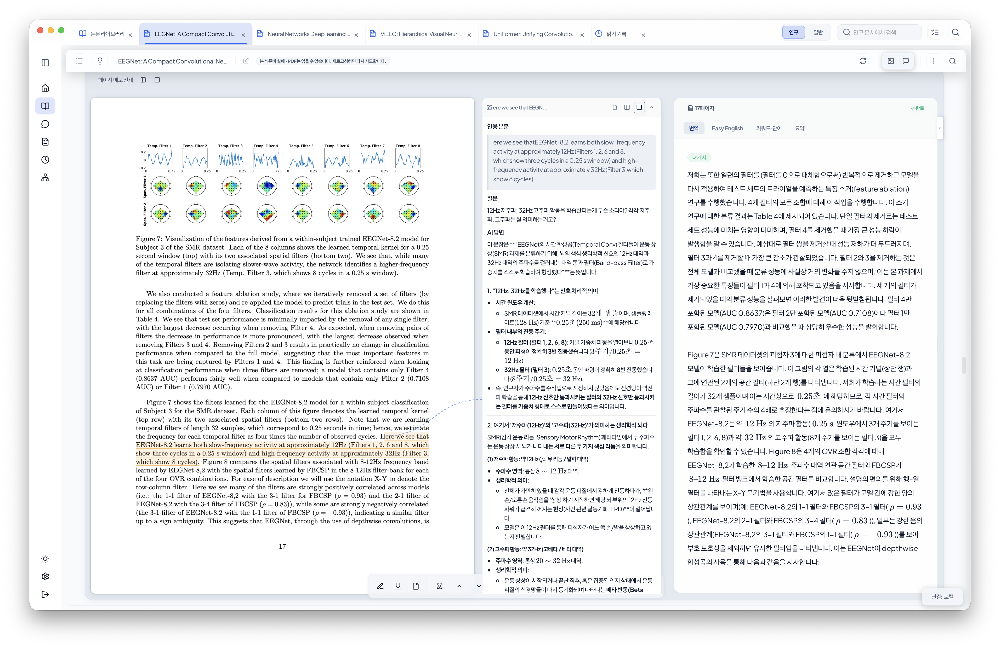

<div align="center">


[](./README.md)

[](https://github.com/orion-gz/EasyPaper/stargazers)
[](https://github.com/orion-gz/EasyPaper/releases) [](https://github.com/orion-gz/EasyPaper/actions)
[](https://github.com/orion-gz/EasyPaper/commits/main)

  

</div>

EasyPaper는 PDF를 AI로 번역하고, 읽고, 주석을 남기고, 문서 내용을 바탕으로 대화할 수 있는 웹·데스크톱 워크스페이스입니다. 로컬 Ollama, Gemini, Claude, OpenAI와 Antigravity·Claude Code·Codex CLI를 지원합니다.

<p align="center">
  
</p>

## 두 가지 읽기 모드

| 모드 | 대상 | 주요 기능 |
|---|---|---|
| 연구 모드 | 논문, 서베이, 학위 논문, 프리프린트, 학술 보고서 | 논문 구조·방법론·근거·인용 분석, 연구 그래프, 논문 비교, 읽기 전 브리핑 |
| 일반 문서 모드 | 기술 문서, 서적, 기사, 보고서, 매뉴얼, 정책 문서, 발표 자료 등 | 문서 유형별 번역, 요약, 어휘, 문서 중심 질의응답, 전문 검색, 문서 개요 |

현재 두 모드 모두 PDF를 입력으로 사용합니다. 일반 문서 모드에서는 문서 목적과 유형에 맞는 기능을 활용할 수 있습니다.

## Lab Mode

웹과 원격 연결 데스크톱에서 공유 EasyPaper 서버의 계정·문서·AI 서비스를 사용할 수 있습니다. 관리자는 멤버 계정과 공유 모델을 관리하고, SSH를 통해 추론 서버에 연결할 수 있습니다. [Lab Mode 설정 가이드](./docs/lab-mode.md)

## 원격 서버 연결 및 동기화

데스크톱 앱에서 로컬 사용과 원격 EasyPaper 서버 연결을 전환할 수 있습니다. 라이브러리를 양방향으로 동기화하고, 로컬에 캐시한 원격 문서를 오프라인에서 열 수 있습니다. [데스크톱 원격 서버 연결 가이드](./docs/desktop-remote-server.md)

## 주요 기능

- 원문과 AI 번역문을 나란히 보는 문장 단위 정렬 뷰어
- 문서 맥락 기반 AI 채팅, 읽기 전 브리핑, 요약, 어휘 지원
- 라이브러리, AI Chats, 연구 그래프, 읽기 분석, 추천을 갖춘 연구 워크스페이스
- 하이라이트, 주석, 플로팅 메모, 주석 포함 PDF 내보내기
- 연구 PDF의 인용·그림·표·수식 참조 오버레이
- Windows, macOS, Linux용 네이티브 데스크톱 앱 및 자체 호스팅 웹 앱

### 기타 기능

- 백그라운드 OCR·문서 분석, 접을 수 있는 목차, 이전 읽기 위치 복귀 및 집중 읽기
- 참고문헌 미리보기 카드와 읽기 우선순위, 그림·표·수식 미리보기 및 PDF 선택 영역 고정
- 통합 검색과 명령 팔레트 (`Ctrl/Cmd+K`), 작업 센터에서 문서 처리 진행 확인 및 재시도
- Markdown 메모와 여백 정렬, 문서·번역·채팅·주석·읽기 기록의 ZIP 백업 및 가져오기

## 빠른 시작

### 데스크톱 앱

[최신 릴리스](https://github.com/orion-gz/EasyPaper/releases/latest)에서 설치 파일을 받을 수 있습니다. Tauri 기반 앱에는 백엔드 사이드카가 포함되어 있어 Python과 Node.js 추가 설치가 필요하지 않습니다.

| OS | 설치 파일 |
|---|---|
| Windows | `.msi` 또는 `.exe` |
| macOS (Apple Silicon) | `_aarch64.dmg` |
| Linux | `.AppImage`, `.deb`, 또는 `.rpm` |

첫 실행 시 온보딩에서 AI Provider 를 선택하고 설정합니다. 서명되지 않은 데스크톱 빌드는 운영체제 보안 경고를 표시할 수 있습니다.

> [!IMPORTANT]
> **주의사항**
> macOS: 앱이 완전히 서명되지 않은 상태라 최신 macOS(Ventura 이후)에서는
> 우클릭 → 열기로 우회되지 않고 "앱이 손상되었기 때문에 열 수 없습니다" 라는
> 오해의 소지가 있는 메시지가 뜹니다. 실제로 파일이 손상된 게 아니라 다운로드
> 시 붙는 quarantine 속성 때문이니, 터미널에서 아래 명령으로 지운 뒤 다시
> 실행하세요.
> ```bash
> xattr -cr /Applications/EasyPaper.app
> ```
> Windows: "Windows의 PC 보호" 화면에서 추가 정보 → 실행을 선택하면
> 정상적으로 설치됩니다.

### 소스로 실행하기

Python 3.8+, Node.js 16+, npm이 필요합니다. Ollama는 선택 사항입니다.
아래 스크립트를 통해 쉽게 실행할 수 있습니다.

```bash
git clone https://github.com/orion-gz/EasyPaper.git
cd EasyPaper
./scripts/sh/setup.sh
./scripts/sh/start.sh
```

Windows에서는 `scripts\bat\setup.bat`을 실행한 뒤 `scripts\bat\start.bat`을 실행하세요. 서버가 시작되면 `http://localhost:8000`에서 사용할 수 있습니다.

## Docker

```bash
git clone https://github.com/orion-gz/EasyPaper.git
cd EasyPaper
docker compose up -d --build
```

서버는 `http://localhost:8000`에서 실행됩니다. 데이터는 `/data` 볼륨에 보존되며, 중지는 `docker compose down`으로 할 수 있습니다.

## 초기 계정

| 항목 | 값 |
|---|---|
| 아이디 | `admin` |
| 비밀번호 | `admin` |

로그인 후 설정에서 계정을 변경하세요.

## 테스트

```bash
cd backend
.venv/bin/pip install -r requirements-dev.txt
.venv/bin/python -m pytest tests/ -v
```

```bash
cd frontend
npm install
npm run build
npm run test:e2e
```

## CLI 기반 AI Provider

EasyPaper는 시작 시 설치·로그인된 `agy`, `claude`, `codex` CLI를 감지합니다. 감지된 공급자는 모델 선택기에서 바로 사용할 수 있으며 API 공급자와 Ollama도 함께 지원합니다.

변경 이력은 [CHANGELOG.md](./CHANGELOG.md)에서 확인할 수 있습니다.
